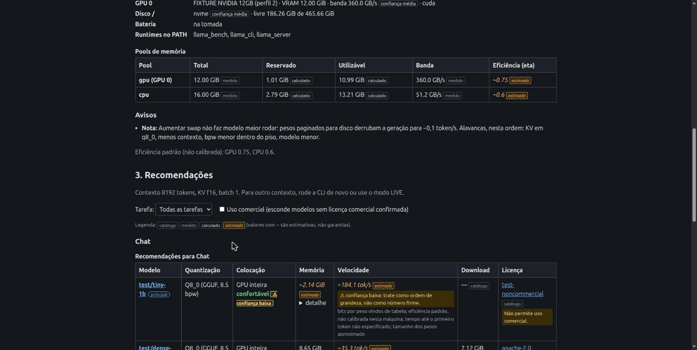

# LocalAI Scout

[](https://github.com/JkFa/localai-scout/actions/workflows/ci.yml)

Ferramenta que lê o hardware da sua máquina e recomenda modelos de IA locais que de fato rodam nela.

## Por que

- Nenhum número vem de LLM. Memória, offload e viabilidade são calculados por funções puras e testadas.
- Um modelo só é recomendado se existir no catálogo com `source_url`.
- Campo que não pôde ser obtido fica vazio e o registro é marcado como incompleto. Nada é inventado.

## Instalação

Requer Python 3.11 ou superior.

```bash
pip install -e .
```

## Uso

```bash
# Lê o hardware e gera system.json
scout collect

# Se a coleta não conseguir ler a memória, gere a saída do dmidecode e passe o arquivo:
sudo dmidecode -t memory > mem.txt
scout collect --dmidecode mem.txt

# Recomendações para um contexto de 8192 tokens
scout plan --ctx 8192

# Exporta a análise de viabilidade para o frontend
scout plan --system system.json --json > feasibility.json

# Backend local (127.0.0.1:8765), imprime o token de acesso
scout serve

# Gerenciamento do catálogo
scout catalog add
scout catalog check
scout catalog remove
```

## Frontend

Disponível em https://jkfa.github.io/localai-scout/. Há dois modos:

- **ARQUIVO** (caminho primário): envie o `feasibility.json` gerado pela CLI. Funciona sempre, sem backend e offline.
- **LIVE**: abra o link impresso por `scout serve`. O frontend conversa com o backend local por HTTP.

Safari: use o modo ARQUIVO.



## Privacidade

- Nada sai da máquina. Não há telemetria, analytics nem CDN de terceiros no frontend.
- O `system.json` não vai para o repositório. Ele fica local, salvo se você o enviar manualmente.
- O backend escuta apenas em `127.0.0.1`.
- `ANTHROPIC_API_KEY`, se usada, é lida somente do ambiente.

## Limitações conhecidas

- Tokens por segundo são desconhecidos, porque a estimativa depende da banda de memória da máquina, que ainda não é coletada.
- Tempo até o primeiro token (ttft) não é estimado.
- `scout bench` e `scout report` ainda não estão implementados.
- macOS e Windows têm suporte de melhor esforço.
- O backend é local por necessidade, para ler o hardware. Não é uma escolha de arquitetura para uso remoto.

## Desenvolvimento

```bash
pip install -e '.[dev]'
pytest -q
python -m http.server -d web 5173   # frontend em http://localhost:5173
```
